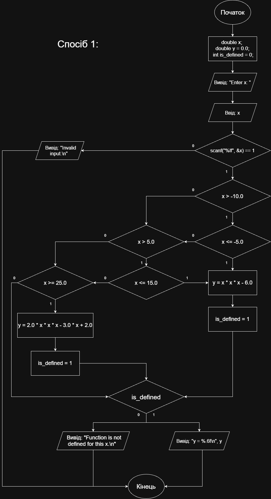
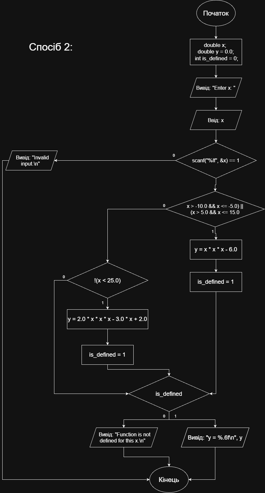
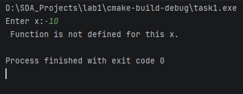
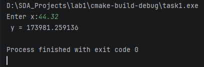
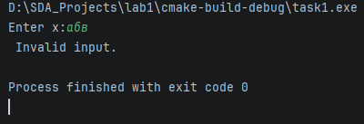
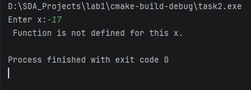
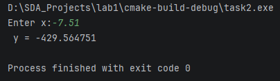
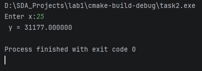

<div align="center">

Національний технічний університет України<br>
«Київський політехнічний інститут ім. І. Сікорського»<br>
Факультет інформатики та обчислювальної техніки<br>
Кафедра обчислювальної техніки

<br><br><br><br>

**Структури даних і алгоритми**<br>
**Лабораторна робота №1**<br>
«Розгалужені алгоритми»

<br><br><br><br><br>

</div>

<div align="right">

Виконав:<br>
студент групи ІО-63<br>
Михайленко Максим Володимирович<br>
Номер у списку групи: 15<br>
Перевірив:<br>
Русінов Володимир Володимирович

</div>

<br><br><br><br><br><br><br><br><br><br><br>

<div align="center">

Київ 2026р.

</div>

---

## 2. Завдання на лабораторну роботу та умова завдання за варіантом

**Варіант:** 15

Для заданого дійсного $x$ обчислити значення кусочно-заданої функції:

$$
y(x) = \begin{cases}
x^3 - 6, & x \in (-10, -5] \cup (5, 15] \\
2x^3 - 3x + 2, & x \in [25, +\infty)
\end{cases}
$$

Якщо $x$ не належить жодному з указаних проміжків, вивести повідомлення про те, що функція не визначена. Реалізувати два способи розв'язання:
* **Спосіб 1 (без логічних операторів):** перевірка інтервалів через вкладені умовні оператори порівняння.
* **Спосіб 2 (з логічними операторами):** перевірка інтервалів із застосуванням логічних операторів (`&&`, `||`, `!`).

---

## 3. Блок-схеми виконаного завдання для 1 і 2 способу





---

## 4. Код обох програм

### Спосіб 1 (без логічних операторів)

```c
#include <stdio.h>

int main(void) {
    double x;
    double y = 0.0;
    int is_defined = 0;

    printf("Enter x: ");
    if (scanf("%lf", &x) == 1) {
        if (x > -10.0) {
            if (x <= -5.0) {
                y = x * x * x - 6.0;
                is_defined = 1;
            } else {
                if (x > 5.0) {
                    if (x <= 15.0) {
                        y = x * x * x - 6.0;
                        is_defined = 1;
                    } else {
                        if (x >= 25.0) {
                            y = 2.0 * x * x * x - 3.0 * x + 2.0;
                            is_defined = 1;
                        }
                    }
                } else {
                    if (x >= 25.0) {
                        y = 2.0 * x * x * x - 3.0 * x + 2.0;
                        is_defined = 1;
                    }
                }
            }
        } else {
            if (x >= 25.0) {
                y = 2.0 * x * x * x - 3.0 * x + 2.0;
                is_defined = 1;
            }
        }

        if (is_defined) {
            printf("y = %.6f\n", y);
        } else {
            printf("Function is not defined for this x.\n");
        }
    } else {
        printf("Invalid input.\n");
    }

    return 0;
}
```

### Спосіб 2 (з логічними операторами)

```c
#include <stdio.h>

int main(void) {
    double x;
    double y = 0.0;
    int is_defined = 0;

    printf("Enter x: ");
    if (scanf("%lf", &x) == 1) {
        if ((x > -10.0 && x <= -5.0) || (x > 5.0 && x <= 15.0)) {
            y = x * x * x - 6.0;
            is_defined = 1;
        } else if (!(x < 25.0)) {
            y = 2.0 * x * x * x - 3.0 * x + 2.0;
            is_defined = 1;
        }

        if (is_defined) {
            printf("y = %.6f\n", y);
        } else {
            printf("Function is not defined for this x.\n");
        }
    } else {
        printf("Invalid input.\n");
    }

    return 0;
}
```

---

## 5. Результати тестування програм:








---

## 6. Висновки

В даній лабораторній роботі я використав 2 різні способи написання програми, яка рахує значення функції при значенні х, введеному користувачем. Перший спосіб полягає в використанні лише одиничних операцій порівняння, а другий допускає і логічні. Другий спосіб дозволяє перевірити 2 умови одночасно, що економить час і робить код більш компактним. В коді перевірена належність введеного числа $x \in (-10; -5] \cup (5; 15] \cup [25; +\infty)$ за допомогою розгалужень і порівнянь. Граничні випадки перевірено за допомогою логічних та одиничних операцій порівняння. Результати обох програм збіглися при тестуванні. Виникли труднощі при написанні програми без логічних операцій через велику кількість вкладених розгалужень.
