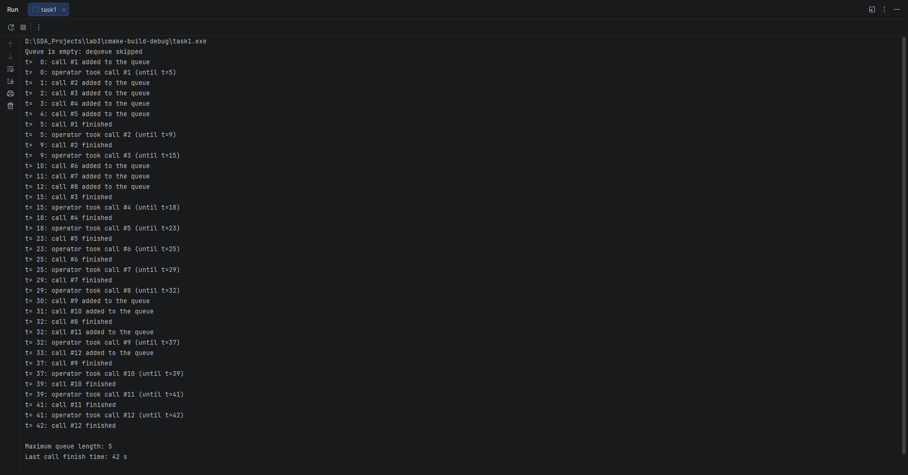
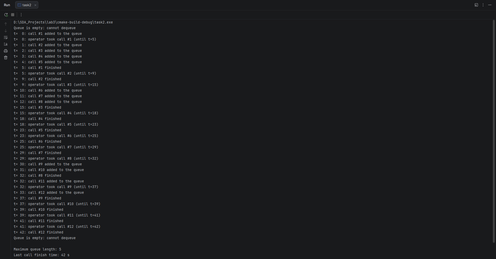
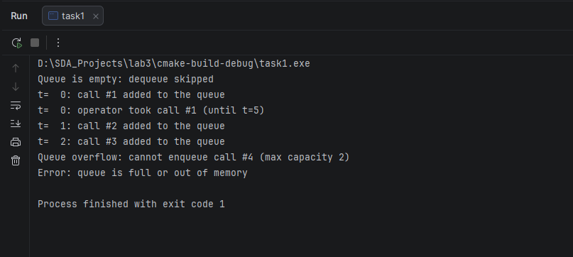

<div align="center">

Національний технічний університет України<br>
«Київський політехнічний інститут ім. І. Сікорського»<br>
Факультет інформатики та обчислювальної техніки<br>
Кафедра обчислювальної техніки

<br><br><br><br>

**Структури даних і алгоритми**<br>
**Лабораторна робота №3**<br>
«Стеки та черги»

<br><br><br><br><br>

</div>

<div align="right">

Виконав:<br>
студент групи ІО-63<br>
Михайленко Максим Володимирович<br>
Номер у списку групи: 15<br>
Перевірив:<br>
Русінов Володимир Володимирович

</div>

<br><br><br><br><br><br><br><br><br><br><br>

<div align="center">

Київ 2026р.

</div>

---

## 2. Завдання на лабораторну роботу і умови завдання
* Написати дві програми, що реалізують ту саму структуру даних двома способами:
  * на основі одновимірного масиву фіксованого розміру (з окремими змінними/індексами для вершини стека або голови й хвоста черги);
  * на основі однозв'язного списку (динамічне виділення пам'яті: вузол зі значенням і вказівником на наступний вузол);
* прикладна логіка в обох програмах має бути однаковою, відрізнятися має лише внутрішня реалізація черги;
* реалізувати єдиний набір функцій для черги (`enqueue`, `dequeue`, `peek_front`, `is_empty`, `is_full` та допоміжні функції ініціалізації/очищення);
* розмір масиву задати іменованою константою (у межах 50–100 елементів) і зробити чергу кільцевою без зсуву елементів;
* виконувати операції додавання та вилучення за сталий час $O(1)$, без готових бібліотечних реалізацій та з обов'язковим звільненням пам'яті (free) у списковій версії;
### Умова варіанту 15:
Чергою змоделювати обробку викликів у call-центрі (виклики надходять у чергу з відомою тривалістю розмови), визначити максимальну довжину черги за час симуляції та час завершення обробки останнього виклику.

---

## 3. Код обох програм

### Спосіб 1 (на основі одновимірного масиву фіксованого розміру):
```c
#include <stdio.h>

typedef struct {
    int id;
    int arrival;
    int duration;
} Call;

#define QUEUE_CAPACITY 100

static Call data[QUEUE_CAPACITY];
static int head  = 0;
static int tail  = 0;
static int count = 0;

void queue_init(void) {
    head = tail = count = 0;
}

void queue_destroy(void) {
    head = tail = count = 0;
}

int is_empty(void) {
    return count == 0;
}

int is_full(void) {
    return count == QUEUE_CAPACITY;
}

int enqueue(Call c) {
    if (is_full()) return 0;
    data[tail] = c;
    tail = (tail + 1) % QUEUE_CAPACITY;
    count++;
    return 1;
}

int dequeue(Call *out) {
    if (is_empty()) return 0;
    *out = data[head];
    head = (head + 1) % QUEUE_CAPACITY;
    count--;
    return 1;
}

int peek_front(Call *out) {
    if (is_empty()) return 0;
    *out = data[head];
    return 1;
}

#define CALLS_COUNT 12

int main(void) {
    Call calls[CALLS_COUNT] = {
        { 1,  0, 5}, { 2,  1, 4}, { 3,  2, 6}, { 4,  3, 3},
        { 5,  4, 5}, { 6, 10, 2}, { 7, 11, 4}, { 8, 12, 3},
        { 9, 30, 5}, {10, 31, 2}, {11, 32, 2}, {12, 33, 1}
    };

    int clock = 0;
    int next_call = 0;
    int processed = 0;
    int serving = 0;
    int busy_until = 0;
    int queue_len = 0;
    int max_len = 0;
    int last_finish = 0;
    Call current;

    queue_init();

    while (processed < CALLS_COUNT) {
        if (serving && clock >= busy_until) {
            serving = 0;
            processed++;
            last_finish = busy_until;
            printf("t=%3d: call #%d finished\n", clock, current.id);
        }

        while (next_call < CALLS_COUNT && calls[next_call].arrival <= clock) {
            if (!enqueue(calls[next_call])) {
                printf("Error: queue is full or out of memory\n");
                queue_destroy();
                return 1;
            }
            queue_len++;
            printf("t=%3d: call #%d added to the queue\n",
                   clock, calls[next_call].id);
            next_call++;
        }

        if (!serving && !is_empty()) {
            dequeue(&current);
            queue_len--;
            serving = 1;
            busy_until = clock + current.duration;
            printf("t=%3d: operator took call #%d (until t=%d)\n",
                   clock, current.id, busy_until);
        }

        if (queue_len > max_len) max_len = queue_len;

        clock++;
    }

    queue_destroy();

    printf("\nMaximum queue length: %d\n", max_len);
    printf("Last call finish time: %d s\n", last_finish);
    return 0;
}
```

### Спосіб 2 (на основі однозв'язного списку):
```c
#include <stdio.h>
#include <stdlib.h>

typedef struct {
    int id;
    int arrival;
    int duration;
} Call;

typedef struct Node {
    Call data;
    struct Node *next;
} Node;

static Node *front = NULL;
static Node *rear  = NULL;

void queue_init(void) {
    front = rear = NULL;
}

int is_empty(void) {
    return front == NULL;
}

int is_full(void) {
    return 0;
}

int enqueue(Call c) {
    Node *n = (Node *)malloc(sizeof(Node));
    if (n == NULL) return 0;
    n->data = c;
    n->next = NULL;
    if (rear == NULL) front = n;
    else rear->next = n;
    rear = n;
    return 1;
}

int dequeue(Call *out) {
    if (is_empty()) return 0;
    Node *n = front;
    *out = n->data;
    front = n->next;
    if (front == NULL) rear = NULL;
    free(n);
    return 1;
}

int peek_front(Call *out) {
    if (is_empty()) return 0;
    *out = front->data;
    return 1;
}

void queue_destroy(void) {
    Call tmp;
    while (dequeue(&tmp)) {}
}

#define CALLS_COUNT 12

int main(void) {
    Call calls[CALLS_COUNT] = {
        { 1,  0, 5}, { 2,  1, 4}, { 3,  2, 6}, { 4,  3, 3},
        { 5,  4, 5}, { 6, 10, 2}, { 7, 11, 4}, { 8, 12, 3},
        { 9, 30, 5}, {10, 31, 2}, {11, 32, 2}, {12, 33, 1}
    };

    int clock = 0;
    int next_call = 0;
    int processed = 0;
    int serving = 0;
    int busy_until = 0;
    int queue_len = 0;
    int max_len = 0;
    int last_finish = 0;
    Call current;

    queue_init();

    while (processed < CALLS_COUNT) {
        if (serving && clock >= busy_until) {
            serving = 0;
            processed++;
            last_finish = busy_until;
            printf("t=%3d: call #%d finished\n", clock, current.id);
        }

        while (next_call < CALLS_COUNT && calls[next_call].arrival <= clock) {
            if (!enqueue(calls[next_call])) {
                printf("Error: queue is full or out of memory\n");
                queue_destroy();
                return 1;
            }
            queue_len++;
            printf("t=%3d: call #%d added to the queue\n",
                   clock, calls[next_call].id);
            next_call++;
        }

        if (!serving && !is_empty()) {
            dequeue(&current);
            queue_len--;
            serving = 1;
            busy_until = clock + current.duration;
            printf("t=%3d: operator took call #%d (until t=%d)\n",
                   clock, current.id, busy_until);
        }

        if (queue_len > max_len) max_len = queue_len;

        clock++;
    }

    queue_destroy();

    printf("\nMaximum queue length: %d\n", max_len);
    printf("Last call finish time: %d s\n", last_finish);
    return 0;
}
```
---

## 4. Результати тестування програм
**Рис. 1:** программа 1 за звичайних умов (в самій програмі перевіряється спроба виконати операцію на порожній структурі, що видно перед початком роботи)

**Рис. 2:** программа 2 за звичайних умов (в самій програмі перевіряється спроба виконати операцію на порожній структурі, що видно перед початком роботи)

**Рис. 3:** программа 1 при спробі додати елемент у заповнену структуру


---

## 5. Висновок
У ході лабораторної роботи я реалізував чергу для симуляції колл-центру на базі кільцевого масиву та однозв'язного списку. Кільцевий масив має жорстке обмеження місткості (QUEUE_CAPACITY) і одразу займає фіксований блок пам'яті без витрат на покажчики вузлів. Однозв'язний список не має заданого ліміту довжини (обмежується лише вільною пам'яттю) та виділяє вузли динамічно, але витрачає пам'ять на покажчик next і час на malloc/free. На порожній черзі обидві програми завдяки перевірці is_empty() безпечно повертають 0 і виводять повідомлення без аварійного завершення. На заповненій черзі масив блокує додавання через is_full() без виходу за межі буфера, тоді як динамічний список переповнення місткості не має. Кільцевий масив доцільно обирати при відомому або жорстко обмеженому розмірі черги та вимогах до стабільної роботи з пам'яттю, а однозв'язний список — при непередбачуваному піковому навантаженні та небажанні тримати великий буфер про запас.
